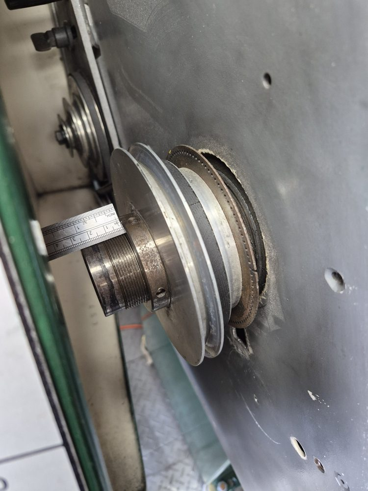
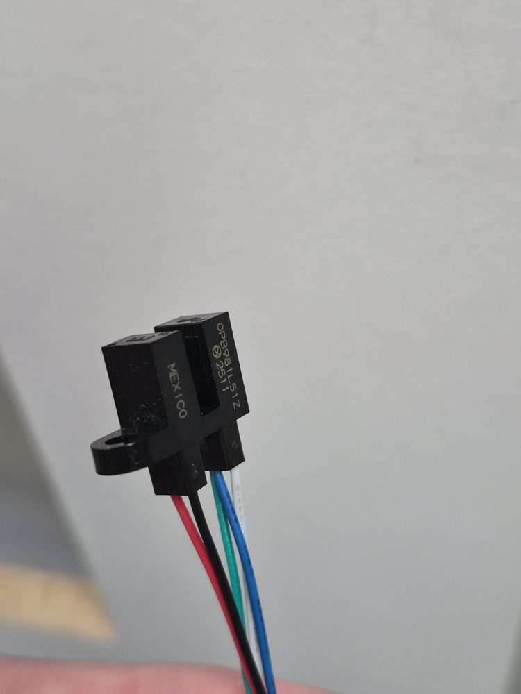
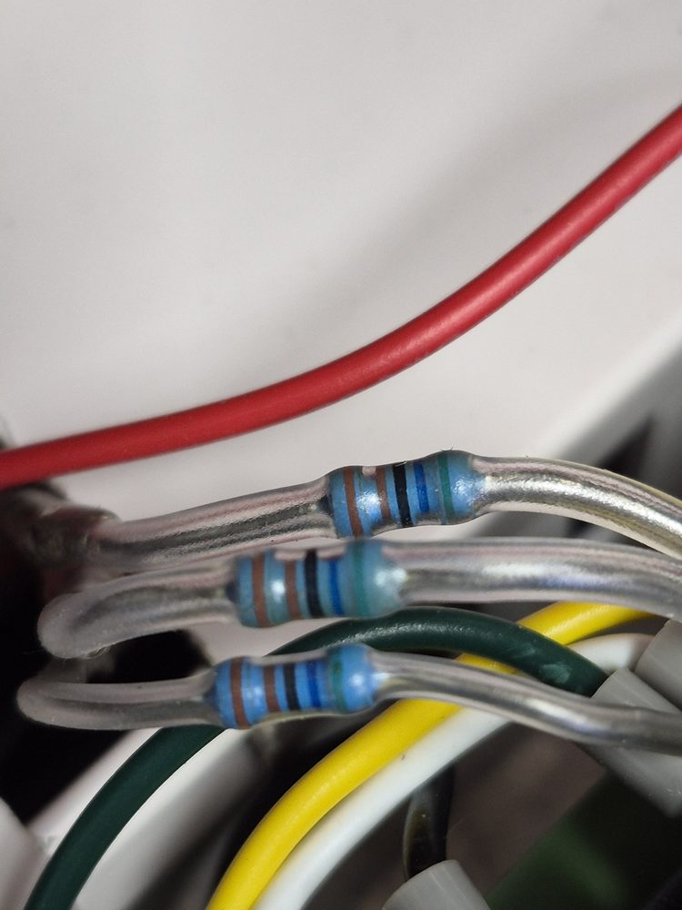
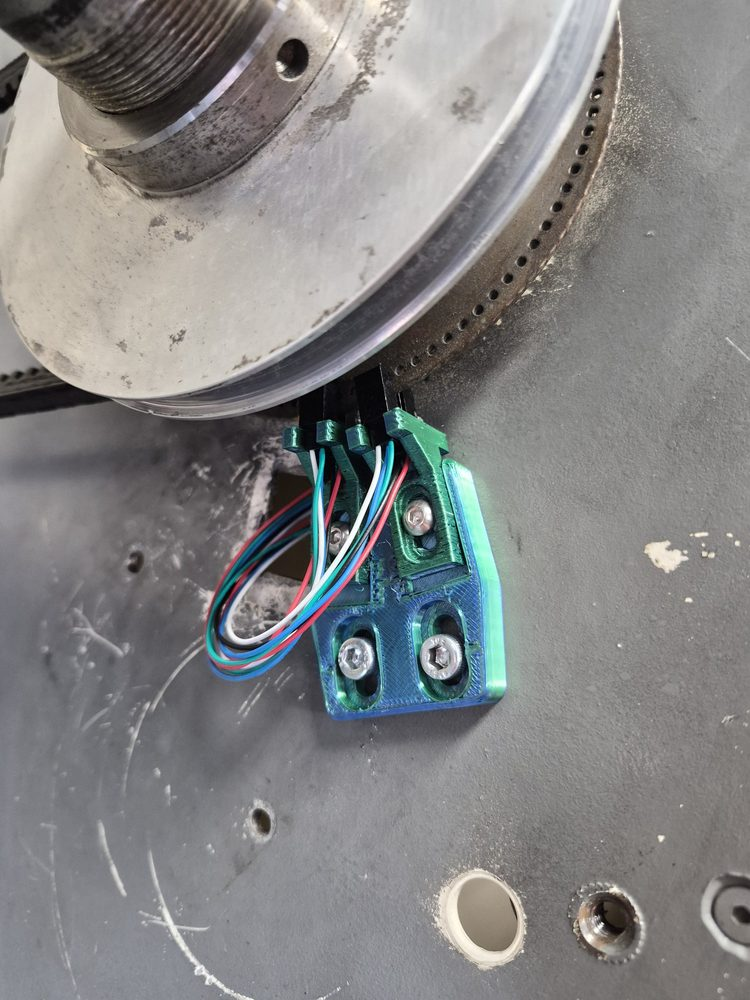
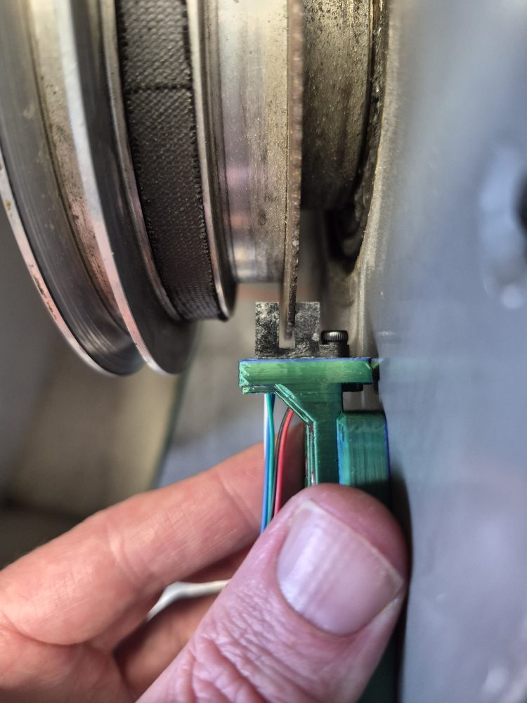
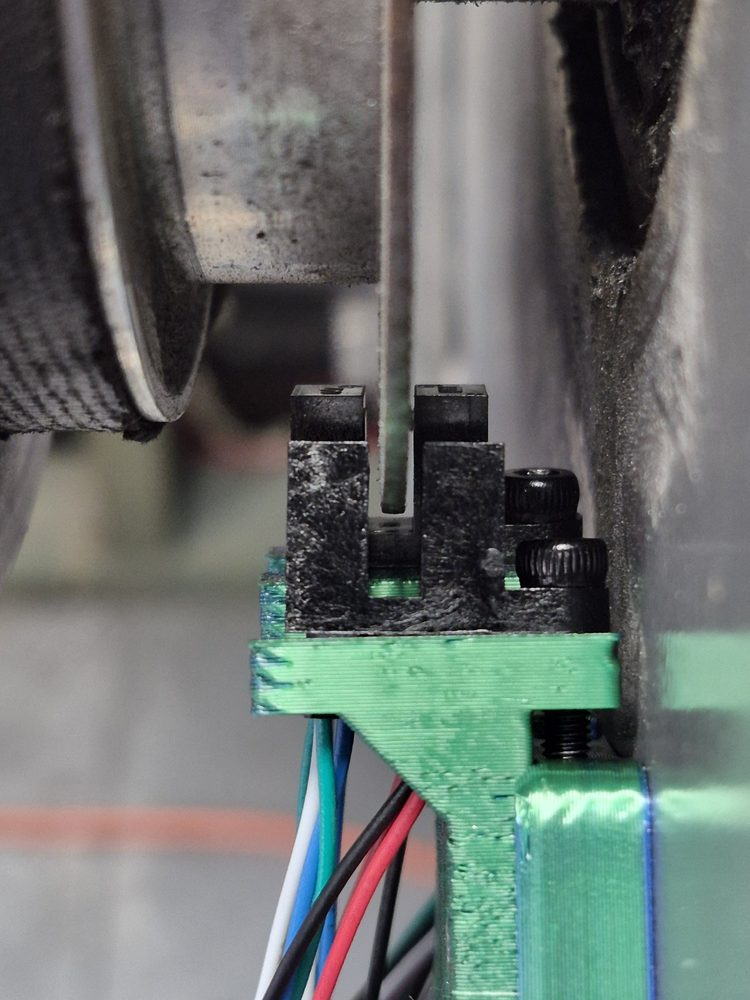
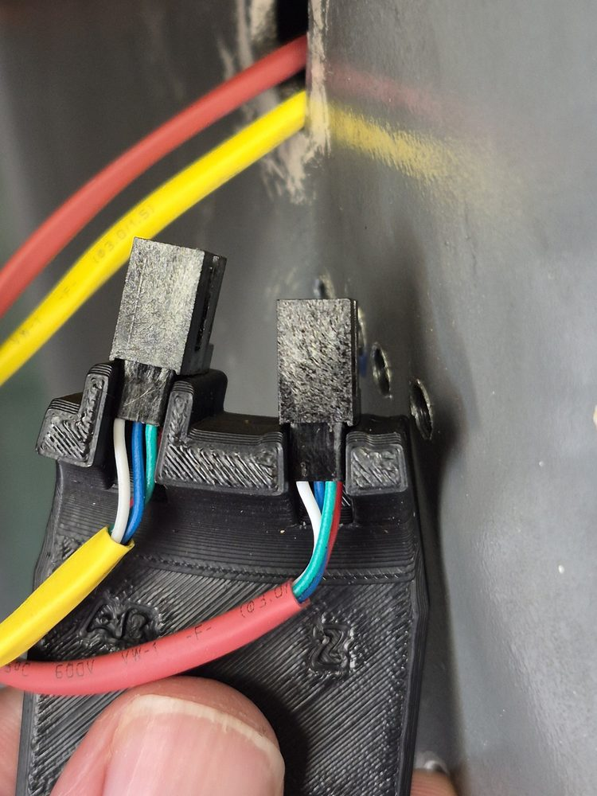
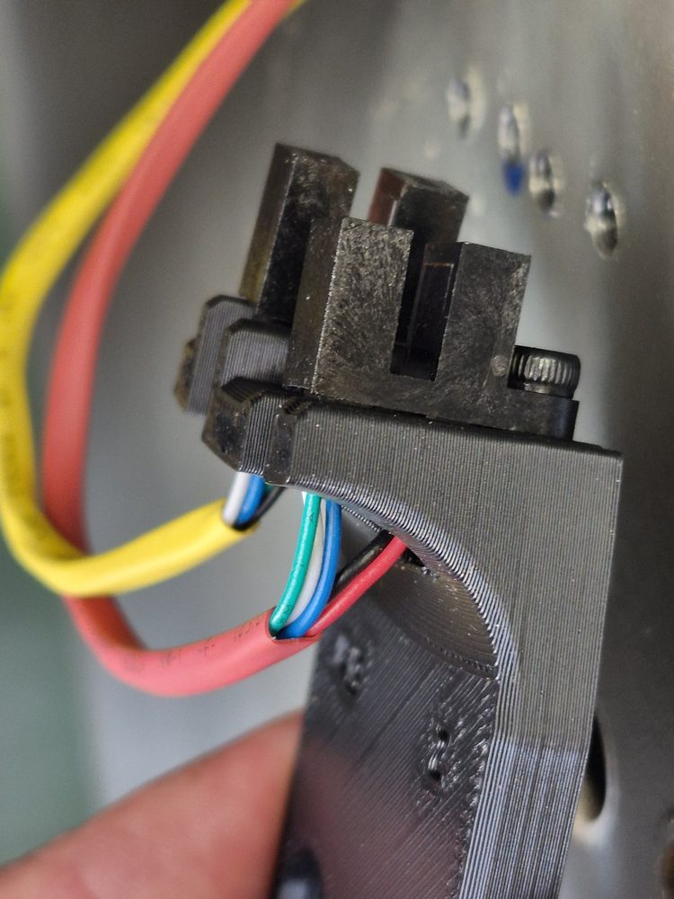
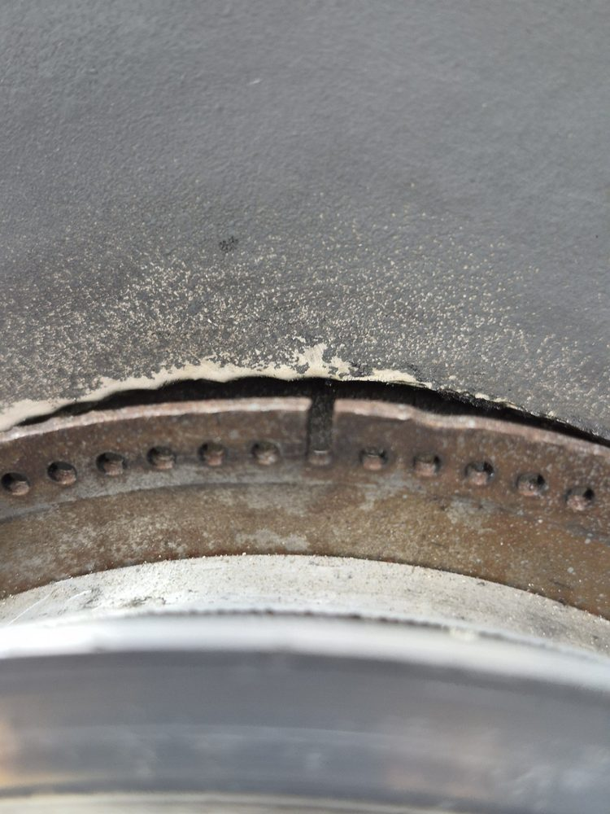

My Boxford TCL 240 CNC lathe now has a working spindle encoder. Rather than
fit a commercial rotary encoder, I reused the encoder disc that's still on the
spindle behind the pulley, and read it with two Optek OPB981 slotted optical
sensors held in 3D-printed brackets. One sensor reads the ring of holes and the
other reads the index notch. The Masso G3 reads spindle speed from them, and
after some calibration S500 to S2000 all read within half a percent. Getting
there took an adjustable test rig, several brackets, and a few surprises,
including a disc with 99 holes rather than 100.

## Why the lathe needs an encoder

The Masso needs to know where the spindle is to cut threads: for G32 it
synchronises the Z feed to the spindle, and the index pulse tells it where
each pass should start so successive passes land in the same groove. Its
spindle encoder inputs take A, B and Z channels. They're opto-isolated, accept
5 to 24 V signals, and are rated to 60 kHz, which is far more than this
disc will ever produce: 99 holes at 3000 rpm is about 5 kHz.

## The disc and the space around it

The Boxford already has a steel encoder disc on the spindle: a ring of small
holes near the rim, plus an index notch. It sits very close to the headstock
panel, with the spindle pulley right behind it, so there isn't much room.
These are the dimensions that mattered:

- Disc diameter about 128 mm, with the hole ring about 4 mm in from the edge.
- The disc's panel-side face is 12.0 mm from the panel (more on how I got that
  number below).
- The disc is about 1.83 mm thick, worked out from feeler gauges in the
  sensor slot rather than measured directly, because calipers can't get in
  between the pulley and the panel.
- The pulley sits about 27 mm off the panel, which caps how tall a bracket can be.

## The sensor: Optek OPB981L51Z

The OPB981L51Z is part of TT Electronics' Photologic family of slotted
optical switches. It has an LED on one side of a 3.18 mm slot and a detector
with a built-in Schmitt trigger and buffer on the other. Its open-collector
output goes high when the beam is unblocked. Because the conditioning is built
in, it gives clean edges instead of an analogue signal that needs squaring up.
The L51Z version has wire leads that come straight out of two small stubs on
the back.

The details that drove the bracket design were:

- **Beam height.** The beam sits 5.97 mm above the bottom of the slot. To put it
  in the middle of the hole ring, the disc edge has to sit about 2 mm from the
  slot bottom. A 2 mm drill shank in the slot makes a handy depth gauge.
- **Slot width.** With a 3.18 mm slot and a disc about 1.83 mm thick, there's
  only about 0.7 mm of clearance each side. The sensor's height off the panel
  has to be right to a few tenths.
- **Fixing.** There's one M3 hole in a tab at one end, and that's it.
- **Supply.** It runs on 4.5 to 16 V, so it can share the Masso's 12 V supply.

## Wiring

Each sensor has five wires. The LED is separate from the detector and needs its
own current-limiting resistor, and the open-collector output needs a pull-up.

| Wire | Function | Connect to |
|---|---|---|
| Red | LED anode | +12 V through 560 Ω |
| Black | LED cathode | 0 V |
| White | Vcc | +12 V |
| Green | Ground | 0 V |
| Blue | Output | Masso encoder input, with 1.5 kΩ to +12 V |

Everything runs from the Masso's own auxiliary 12 V and 0 V terminals, so it's
all on one ground. My supply actually measures about 13 V, which is still well
inside the sensor's 16 V limit.

- **560 Ω LED resistor.** With the LED's forward voltage measuring 1.4 V, that
  gives about 21 mA. That's above the detector's 15 mA switching threshold and
  well under the 40 mA maximum. Each resistor dissipates about 0.24 W, so I
  used 0.5 W metal film; even so, they get warm through the heatshrink. They're
  inline in the red wire.
- **1.5 kΩ pull-up.** This goes from each Masso input terminal to +12 V, at the
  Masso end. The output sinks about 8.7 mA when low, inside its 12.8 mA rating.

The Masso's A, B and Z inputs already had 5.6 kΩ pull-ups from an earlier
setup. They worked when I turned the spindle by hand, but they're too weak to
give clean edges at speed, so I swapped them for the 1.5 kΩ ones.

The hole-ring sensor's output goes to both A and B, linked at the Masso, and
the index sensor feeds Z. With only one sensor on the holes there's no true
quadrature, so the Masso shows the same rpm whichever way the spindle turns. A
third sensor a quarter of a hole pitch from the first would give a proper,
separate B channel for direction. I've designed a
three-sensor bracket for that, but haven't needed it yet.

## Brackets, in two stages

I knew the hole positions and the sensor's exact height off the panel would
need tuning on the machine, so I built an adjustable test rig first, then a
fixed bracket once I knew the numbers. Everything was modelled parametrically
in OpenSCAD, then rebuilt natively in Fusion. Claude did most of the modelling,
building the Fusion versions through Fusion's MCP server.

### The adjustable test rig

The rig has a base plate that bolts to the panel through two slots, plus a
separate carrier for each sensor:

- **Carriers.** Each one slides in a radial groove in the base, with ±4 mm of
  travel read off an engraved 1 mm scale, and locks with an M4 screw into a
  nut trap underneath.
- **Sensor fixing.** The sensor bolts to the face of the carrier through its
  tab, with an M3 nut in a pocket behind.
- **Panel slots.** These give a further ±4 mm of coarse adjustment.

The rig paid for itself. Things it showed up:

- **The sensor wasn't centred on the disc.** On the first fit the disc ran
  against the panel-side arm of the slot. Feeler gauges showed 1.35 mm on the
  pulley side and almost nothing on the panel side. That only proved the slot
  was *at least* 0.67 mm too high, because the disc was already touching. A
  direct measurement of 12.0 mm from the panel to the disc face settled it: the
  slot centre needed to be about 12.9 mm off the panel, not the 13.9 mm I'd
  started with.
- **The stub pocket.** I'd sized it at 0.3 mm clearance each side. The printed
  pocket measured 5.40 mm against 5.43 mm designed, so the printer is
  accurate, and I tightened it to 0.15 mm.
- **The sensor tipped as I tightened the screw.** The leads come straight out
  of the ends of the stubs. The panel-side stub's leads had only 0.6 mm before
  they hit the back of the pocket and had to fold 90°, and that pushed the
  sensor over. The fix was to run the pocket 3 mm past the stub ends, then
  ramp the floor up at 45°, so the leads bend gently instead of folding.

### Panel holes

The adjustable base and the fixed brackets share one panel slot pattern: two
5.5 mm slots 19 mm apart, at 110.5 to 118.5 mm from the spindle centre, with
the same counterbore depth so the same M5 screws fit both. The idea is to find
the right position with the rig, then bolt the fixed bracket into the same
holes. My first holes were a little off, and I ended up re-drilling them.
Afterwards I also made a drilling template that butts up against the disc rim
and has 5 mm guide holes, which I should have made first.

### The fixed bracket

The fixed bracket is a single part. A curved upright carries the sensor seats
at the disc radius, with a cove running down into a base plate that has the
mounting slots. I made an open-topped version for the leads, so already-wired
sensors drop in from above instead of having to be threaded through. That
mattered once the machine was wired up.

The carriers had finished up with the hole-ring sensor one tick (1 mm) further
in and the index sensor on zero, so I moved the bracket's hole-ring seat in by
1 mm to match.

The first fixed print showed something the rig had hidden. The disc touched the
pulley-side arm, so the sensor was sitting about 0.75 mm too low, even though
the bracket used the same slot height as the carriers. The carriers sit on a
stack of printed parts (base plate, groove and foot) that had been adding a few
tenths without me knowing. The fixed bracket sits straight on the panel, so it
showed the true height. I raised the sensor on the fixed bracket only.

The single tab screw also leaned the sensor forward slightly as it tightened.
I measured 0.23 mm between the top of the sensor body and the seat.

The changes for the final version:

- The sensor is raised 0.75 mm.
- The seat leans back about the tab screw, so the sensor finishes upright once
  the screw is tight. I started at 0.85°, which still left it leaning, and the
  current version has 2.5°.
- A 0.8 mm deep locating pocket for the sensor body and tab stops the leads
  twisting the sensor around its single screw.
- An extra M5 socket cap screw near the front holds the bracket down. With
  only the two screws at the back, the front lifted slightly off the panel.

## Masso setup and calibration

### Holes per revolution

I'd assumed the disc had 100 holes, but I counted 99. The index notch is a
narrow slot running from the rim into one of the holes, and the spacing is
even all the way round, so it's 99 evenly spaced holes. The encoder count in
the Masso is set to 99.

### Spindle speed

When the Masso commanded 100 rpm, the encoder read 150. The encoder was right.
The belt makes the spindle turn about 1.5 times faster than the motor, and the
Masso was scaling its 0 to 10 V output for motor speed. I'd previously been
correcting for this in my Fusion post-processor by multiplying every S word,
which meant anything typed in MDI was still wrong. Calibrating the drive
properly fixed it everywhere instead:

1. In the Masso, I set the speed at 10 V to 3320 rpm. I worked that out from
   readings at several speeds. The measured speed followed a straight line,
   roughly 1.11 × S − 12 rpm, at the old setting.
2. That left a small offset at the bottom end. On the Folinn BD600 VFD I set
   `F05.19`, the AI1 setting at its lower voltage point, from 0.0% to 0.4%.
   That lifts the bottom of the 0 to 10 V curve by about 13 rpm. The parameter
   only goes in 0.1% steps, and 0.4% was the closest.
3. I took the ratio back out of the post-processor.

The end result:

| Commanded | Encoder reads | Error |
|---|---|---|
| S100 | 98–99 | about −1.5% |
| S500 | 498–499 | about −0.3% |
| S1000 | 1000 | 0 |
| S2000 | 2007 | about +0.35% |

That's within about half a percent from 500 to 2000 rpm. The 1 to 2 rpm
flicker at S100 is mostly the display: at that speed it only sees about 165
holes a second. None of this affects threading anyway, because the Masso syncs
Z to what the encoder actually measures, not to what S asked for.

## Where it's at

- The encoder works: the Masso reads spindle speed and index from the two
  sensors, and commanded speeds now match the real spindle speed.
- The final fixed bracket, with the raised sensor, 2.5° seat lean and locating
  pocket, is fitted. The front M5 hold-down screw still has to go in.
- **Still to do:** cut a test thread and measure across 20 pitches. That's the
  real check on the 99-hole count and the whole setup. A 1% count error would
  show up as about 0.3 mm over 20 threads at 1.5 mm pitch.
- **Later:** a three-sensor bracket for true A/B quadrature. Its A–B spacing
  needs changing from 22.5° to 22.73° (6.25 × 360 ÷ 99) to suit 99 holes.
- The encoder is also what I'm using to scale speed for the servo spindle
  conversion in [part 1 of that series](/2026/11/22/boxford-lathe-servo-spindle-part-1/).

## Takeaways

- **Count the holes yourself.** I'd assumed 100 and it was 99, which would
  have made every thread about 1% short.
- **Build an adjustable rig first** when a part has to be right to a few
  tenths in a place that's hard to measure. Then remember that the rig's own
  stack of parts can hide an offset the fixed part won't have.
- **Feeler gauges only give a lower bound** when the disc is touching one side.
  Measure the position directly if you can.
- **Fix speed scaling in the controller, not the post-processor**, so MDI and
  programs agree.
- **Give wire-lead sensors room behind them.** Stiff leads folded hard behind a
  sensor held by one screw will tip it.

## References

- [TT Electronics OPB960/970/980/990 Photologic datasheet](https://www.ttelectronics.com/)
- [Masso docs: spindle RPM encoder](https://docs.masso.com.au/wiring-and-setup/setup-and-calibration/spindle-rpm-encoder)
- [Folinn BD600 manual](https://www.manualslib.com/manual/3465266/Folinn-Bd600-Series.html)
