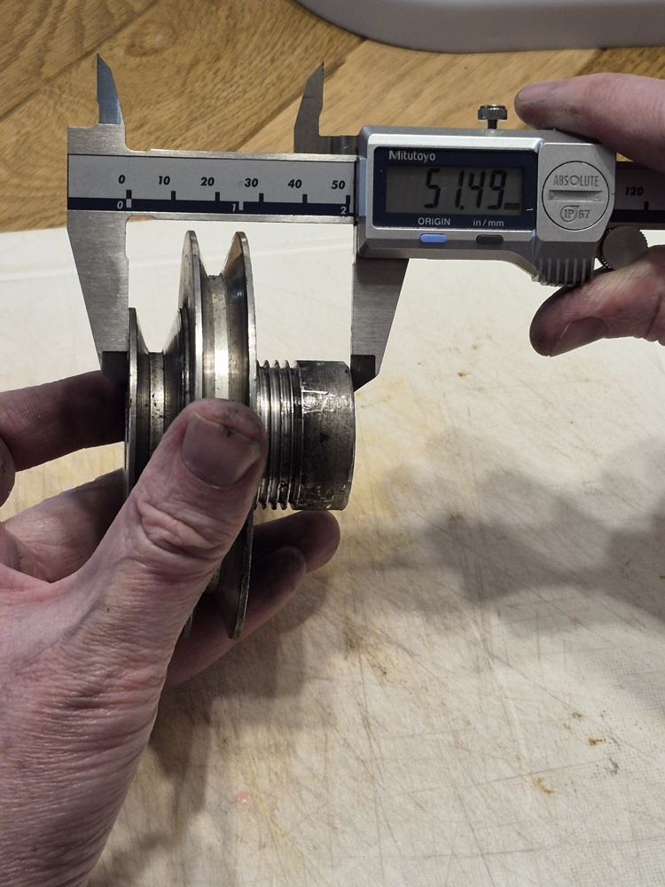
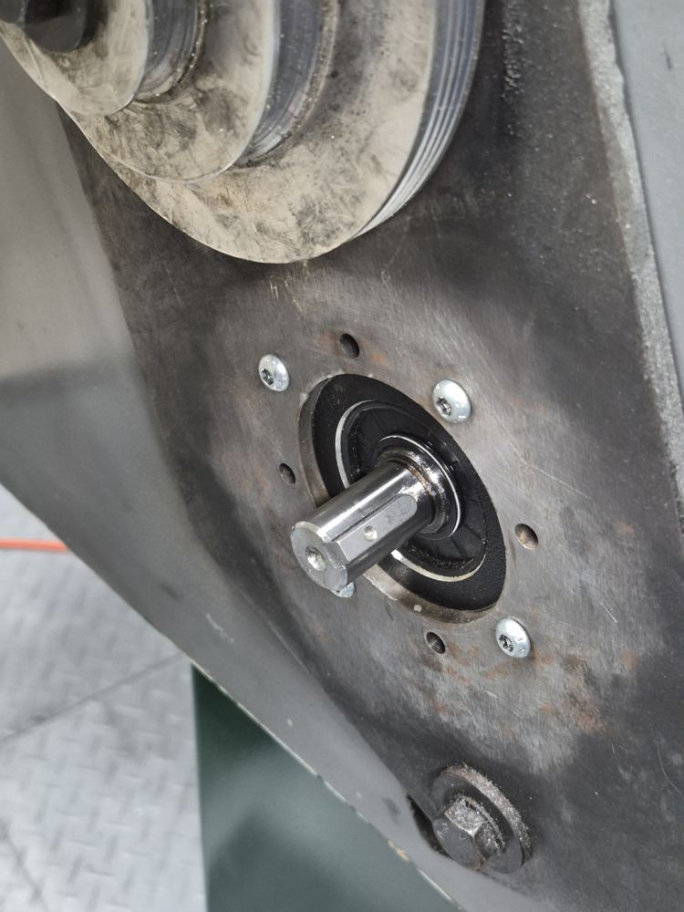
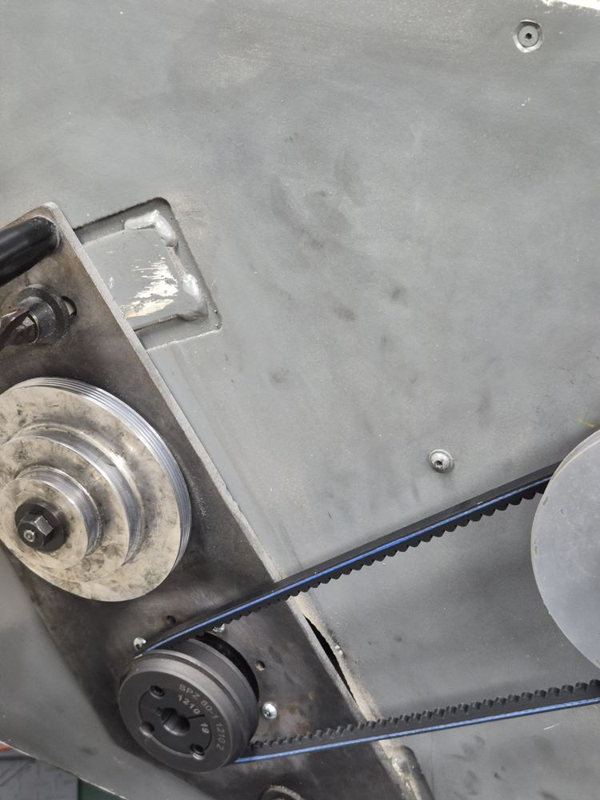
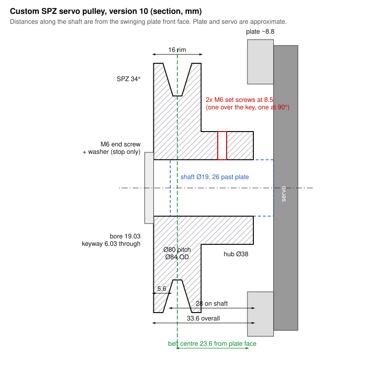
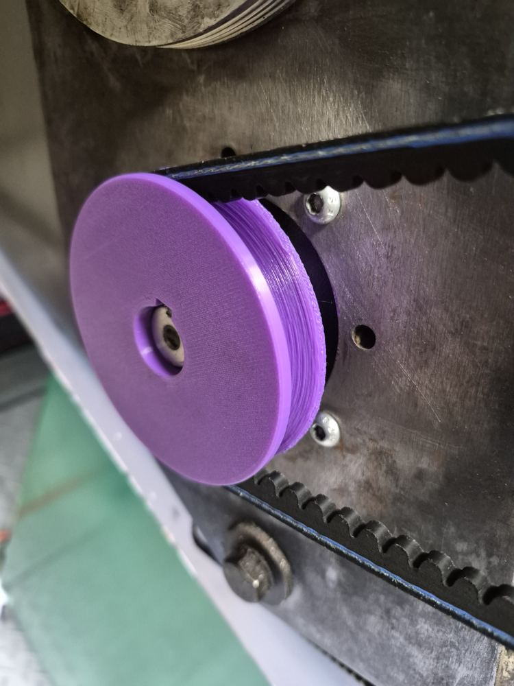
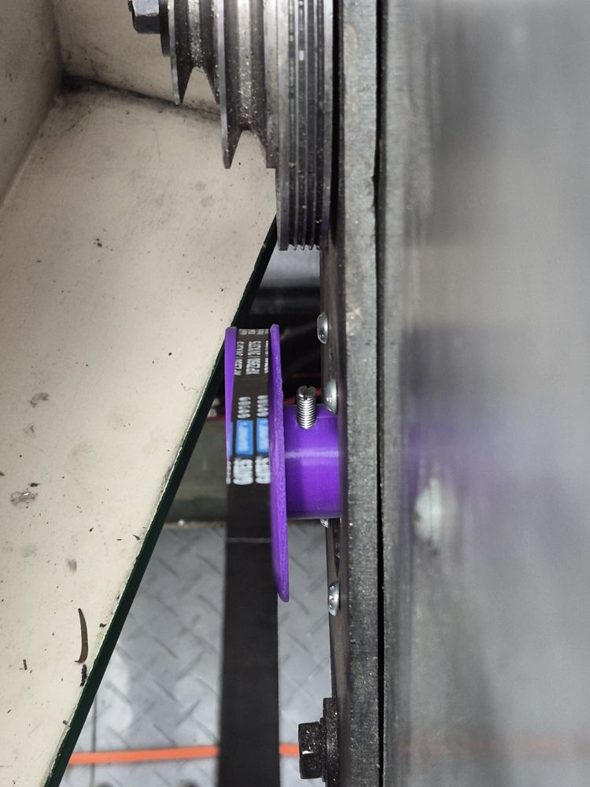

I'm replacing the spindle motor on my Boxford TCL 240 CNC lathe. The old
setup was a 1 hp induction motor on a Folinn BD600 VFD; the new one is a Delta
ASDA-E3 750 W servo, still commanded by the lathe's Masso G3 controller. So
far the servo is mounted, the Masso drives it over 0-10 V with a smooth ramped
stop and no creep, and a custom one-piece 80 mm SPZ pulley has just passed a
3D-printed test fit on the machine. Step/dir control didn't work with the
Masso's spindle outputs, so it's parked for now. This post covers everything
up to that point.

## The goal

The TCL 240 originally had a low-power Lenze DC spindle motor. At some point
it was swapped for a standard 71-frame induction motor (1 hp, 2-pole, 2800 rpm,
14 x 30 mm keyed shaft) on a Folinn BD600 VFD, with the Masso sending a
0-10 V speed signal. Every belt ratio on this machine runs the spindle slower
than the motor, so to reach 3200 spindle rpm the VFD was overspeeding the
motor to around 70 Hz (about 3950 rpm).

The plan is to replace the motor and VFD with a servo that:

- bolts into the same place on the swinging tension plate,
- gives at least the old motor's continuous torque at the spindle, with a lot
  more peak torque,
- holds speed properly under load and stops under control,
- runs in reverse, because I use a rear-mounted parting tool post.

In my normal work I run the spindle at 1000 to 2500 rpm, and I never use the
slow ribbed-belt ranges, so the new drive only needs the top V-belt range.

## Parts

| Part | What it is |
|---|---|
| Delta ECM-E3M-C20807RSE | 750 W servo motor, 80 mm flange, 2.4 Nm rated, 3000 rpm rated / 6000 rpm max, 19 x 35 mm keyed shaft (6 mm key, M6 end tap), oil seal, no brake |
| Delta ASD-E3-0721-L | Matching drive. The **-L** variant is the one with pulse/sign and analog inputs on a 44-pin CN1 connector (the -E variant is EtherCAT only). No STO and no dynamic brake. |
| Delta ACS3-MDTB4400 | CN1 screw-terminal breakout for the -L drive |
| Masso G3 | The lathe's existing controller, running on 12 V |
| Mean Well HDR-15-24 | Small 24 V DIN supply for the drive's digital I/O (COM+), since the Masso runs on 12 V |
| Gates XPZ 950 belt | Cogged SPZ, the same belt the machine already used |
| Custom 80 mm pitch SPZ pulley | One-piece 6061 aluminium, designed below |

The servo and drive cost me AUD 413 together.

Useful references: the
[ASDA-E3 user manual](https://downloadcenter.deltaww.com) (I used the
2026-03-13 English edition) and the Masso docs on
[spindle control](https://docs.masso.com.au/wiring-and-setup/setup-and-calibration/spindle-control)
and [main spindle settings](https://docs.masso.com.au/masso-settings/main-spindle-settings).

## Choosing the pulley ratio

The spindle has two V pulleys, 144 mm and 115 mm OD. The old motor pulley was
a stepped twin-V pulley with a ribbed hub for the slow ranges, bored for the
14 mm shaft, so it couldn't be reused on the 19 mm servo shaft.



I settled on a single-groove 80 mm pitch diameter SPZ motor pulley running on
the 115 mm spindle pulley (about 111 mm pitch). That's a ratio of about 0.72:

- 3200 spindle rpm needs about 4440 motor rpm, well inside the servo's 6000.
- My usual 1000 to 2500 spindle rpm is about 1390 to 3470 motor rpm.
- Torque at the spindle is about 3.3 Nm continuous (2.4 / 0.72) and about
  10.6 Nm peak, against about 3.1 Nm from the old motor.

A 1:1 drive would only have given 2.4 Nm at the spindle. A second groove would
only have added about 27% torque in a lower range, so it wasn't worth the
extra pulley width.

## Mounting the servo

The servo has the same 70 mm spigot as the old 71-frame motor, so it drops
into the existing bore in the swinging plate. The bolt pattern is different
(4 holes on a 90 mm PCD instead of 85 mm), so I rotated the servo 45 degrees,
then drilled 5.0 mm and tapped M6 on the 90 mm PCD in the plate. I made a
3D-printed drilling template in Fusion that locates in the 70 mm bore, and
used a 1/4" transfer punch through it to mark the holes.

The servo bolts to the back of the plate with M6 button-head screws, and the
shaft sticks out about 26 mm past the plate's front face. The plate is about
8.8 mm thick and sits about 8.8 mm proud of the side panel.



The servo doesn't need a brake: the spindle doesn't need to hold position
with the power off.

## Speed control: step/dir first, then back to 0-10 V

### Step/dir (parked)

My first plan was step/dir, with the drive in position (PT) mode. On paper it
fits: the Masso's spindle step/dir output covers 500 to 25,000 pulses/s, and
with 320 pulses per motor rev (`P1.044 = 16777216`, `P1.045 = 320`) the top
speed sits under the 25 kHz cap.

In practice it didn't work:

- The Masso's spindle step/dir outputs are single-ended, about 3 V through
  about 250 ohms, shared with the onboard forward/reverse optocouplers
  (ICs 39 and 40). Wired straight to the E3's PULSE+/SIGN+ inputs (CN1 43 and
  39, with Masso GND on 41 and 37), the drive counted **zero pulses** and the
  motor didn't move.
- Masso's own tip is that pulling the socketed ICs 39 and 40 raises the output
  to about 4.8 V no-load. With them out, the drive did count pulses, but it
  also counted noise, and the motor kept running on after the Masso stopped
  stepping.
- The direction output (pin 3) never switched between M3 and M4. I haven't
  worked out why.

The same servo and drive run fine from my other controller, a grblHAL
FlexiHAL, whose step/dir outputs go through an AM26LS31 5 V differential line
driver. So the drive's input is fine; the Masso's spindle output just isn't
strong or clean enough to drive it directly.

Things I haven't tried yet: a much heavier input filter on the drive
(`P1.000`), or putting a small AM26LS31 line-driver board between the Masso and
the drive. I parked step/dir instead, because 0-10 V is how the Masso drove
the VFD and I wanted to prove the whole system end to end first.

### 0-10 V speed mode (working)

The -L drive has an analog speed input, V_REF, on CN1 pin 20 with analog
ground on pin 19 (10 kOhm input, ±10 V). Wiring is one new pair:

| Masso spindle connector | CN1 pin | Signal |
|---|---|---|
| Pin 1, 0-10 V out | 20 | V_REF |
| GND | 19 | Analog GND |

The step/dir wires can stay connected: in speed mode the drive ignores the
pulse inputs.

Drive parameters I set:

| Parameter | Value | Why |
|---|---|---|
| `P1.001` | `0x0002` | Speed mode, analog command. Power cycle after. Don't use `0x1002`: the U digit resets all the DI assignments to defaults. |
| `P1.040` | `3320` | rpm at 10 V, matching the Masso's max rpm, so the S word equals motor rpm |
| `P1.055` | `3500` | Speed limit. The default caps the motor at its 3000 rpm rating. |
| `P1.034` / `P1.035` | `1000` | Accel and decel time in ms (per 3000 rpm) |
| `P1.036` | `50` | Must be above 0, otherwise the accel/decel ramps aren't applied to an analog command |
| `P2.010` | `0x0001` | Servo on whenever the drive is powered (for now) |
| `P2.015` / `P2.016` | `0` | No limit switches on a spindle |
| `P2.017` | `0x0000` | EMGS input unused. This cleared alarm AL013. |

On the Masso side, the spindle control mode goes from Step/Dir to Analogue.

First results on the bare motor, Masso S word against the drive's speed
readout:

| Commanded | Measured |
|---|---|
| S300 | 303 rpm |
| S2000 | 2019 rpm |
| S3000 | 3008 rpm |

All within 1%. Asking for S3600 (above the Masso's 3320 max) gave 10.11 V at
the drive and 3355.7 rpm, which is exactly 10.11 x 3320 / 10, so the scaling is
right and the Masso's max rpm is what sets the top speed.

### Fixing creep at stop, then the sudden stop

After M5 the motor crept at about 20 rpm. That's about 60 mV left on the Masso
output at 3320 rpm per 10 V. Because S300 read 303 while running, it isn't a
fixed offset, so trimming the analog offset (`P4.022`) wasn't the right fix.

Instead I used the drive's zero-speed clamp, with no extra wiring:

- `P2.036 = 0x0005`: assigns ZCLAMP to the unused DI9 (pin 12) as a normally
  closed input, so with nothing wired it's always active.
- `P1.038 = 50`: anything under 50 rpm counts as zero speed.

That killed the creep, but now M5 stopped the motor abruptly, because the
clamp acts on the raw analog command by default. Bit 10 of `P2.065` makes the
clamp ramp down through the `P1.035` decel time instead.

One gotcha: the manual gives `P2.065`'s default as `0x0300`, but on my drive
it read `0x0104` in ASDA-Soft. Setting the whole register from the manual's
value would have changed other bits. Adding bit 10 to my drive's actual value
gave:

```text
P2.065 = 0x0504
```

Now the motor ramps down smoothly on M5 and holds still. Lesson: for bit-field
registers, read the drive's current value before writing a new one.

### Other wiring

- The drive's alarm output (ALRM, CN1 27/28) goes to a Masso input, so the
  Masso sees a drive fault.
- E-stop: the pendant E-stop goes to the Masso's E-stop input, and the main
  E-stop kills power. The E3 has no STO, so dropping power is the hard stop.
- The Mean Well 24 V supply for COM+ (CN1 11) is on order. It's needed before
  servo-on switching or reverse can work.

## The custom pulley

### Why not off the shelf

I bought a stock 80 mm SPZ taper-lock pulley with a 1210 bush (19 mm bore,
6 mm keyway) and tried it on the servo. The bush is 25.4 mm long, and with the
bush screws on the accessible side, the bush had to overhang the shaft end by
about 12 mm to get the groove on the belt line. That left only about 13 mm on
the shaft, which I wasn't comfortable with. Flipping it hides the screws, and
a re-bored pilot-bore pulley didn't look right either.



So I designed a one-piece pulley in Fusion, with every dimension as a user
parameter.

### Finding the belt line

This took more back and forth than anything else, because some measurements
were from the side panel and some from the swinging plate, which stands about
8.8 mm proud of it. What settled it:

- The belt's far side is 37 to 37.5 mm from the **side panel**, so the belt
  centre is about 32.4 mm from the panel, which is **23.6 mm from the plate's
  front face**.
- Cross-check from the old pulley: its 25.4 mm ribbed hub plus half the
  13.13 mm large sheave puts the old groove at about 23.2 mm from the plate
  face. That agrees within about 0.4 mm.

So the belt centre sits about 2.4 mm inside the end of the servo shaft, which
also keeps the belt load close to the bearing.

### Design (Fusion version 10)



| Feature | Value |
|---|---|
| Groove | SPZ, 34°, 80 mm pitch diameter, 84 mm OD |
| Rim | 16 mm wide, centred 23.6 mm from the plate face |
| Hub | Ø38 mm, runs about 2 mm into the plate's 70 mm bore |
| Length on the shaft | 28 mm, about 4 mm clear of the oil seal |
| Past the shaft end | 5.6 mm, flat outer face flush with the rim |
| Overall length | 33.6 mm |
| Bore | 19.03 mm |
| Keyway | 6.03 mm wide, 21.83 mm from the far side of the bore to the keyway bottom, cut through the full length |
| Set screws | 2x M6 at 8.5 mm from the plate face, one over the key and one at 90° |
| Retention | M6 screw and washer into the shaft's end tap, snugged only as a stop; the set screws carry the load |
| Material | 6061 aluminium, about 0.22 kg |

A few of these came out of specific problems along the way:

- **Bore and keyway sizes.** The servo shaft measured 19.00 / 18.99 mm. The
  machining service I'm using holds ±0.05 mm at the normal price (±0.02 doubles
  it), so I biased the nominal sizes: a 19.03 bore lands between 18.98 and
  19.08. I want a tight fit, and if it comes out slightly undersize, a light
  hone is easier than living with a loose pulley.
- **Keyway through the full length.** An earlier version had the keyway cut
  stopping 2 mm short at the hub end after I lengthened the hub. It's easy to
  miss in a model, so it's worth checking before ordering.
- **Hub diameter.** With a Ø35 hub, the set screw over the key would only have
  had about 5 mm of aluminium to thread into. Ø40 felt like too much material,
  so version 10 uses Ø38, which gives about 6.7 mm over the keyway.
- **Adjustment.** There's about 3 mm of inward and 5 mm of comfortable outward
  travel on the shaft, so I can still fine-tune the belt line on the machine.

### The 3D-printed test fit

Before ordering, I printed the pulley in PLA (with a slightly loose 19.3 mm
bore and 6.3 mm keyway so it would slide on) and fitted it with the real belt.





It passed:

- The belt line matched the spindle pulley within about 0.5 mm, measured with
  a square and rule from the side panel to the belt at both pulleys.
- The belt seated with its top about flush with the rim.
- Nothing clashed with the plate or the button-head screws.
- It turned cleanly by hand.

A straight edge across both pulley faces doesn't work here, because the
unused 144 mm spindle pulley sits further out. For the final alignment I'll
measure from the panel to the belt at two points along the straight run.

## What's next

- **Order the pulley.** Version 10 is ready to send to the machining service
  in 6061 aluminium, with threads cut and a 2D drawing for the bore and
  keyway tolerances. Before ordering I'll measure over the key with calipers
  to confirm the keyway depth.
- **Scale speed for the belt.** With the belt on, the spindle encoder reads
  about 75% of motor speed. Either set `P1.040` to about 4270 and `P1.055` to
  about 4600 with a Masso max of 3200, so the S word is spindle rpm, or keep
  3320 and set the Masso max to about 2490. I'll measure the actual ratio
  first.
- **Reverse.** In speed mode, direction comes from the CMDINV input. The plan
  is the Masso's reverse output to CN1 pin 10 with `P2.011 = 0x0106`. This
  needs the 24 V supply connected first.
- **Servo-on switching** from a Masso output through a DIN solid-state relay,
  instead of servo-on whenever the drive is powered.
- **Step/dir**, maybe, with a proper line driver.

Part 2 will cover fitting the real pulley and finishing the speed and reverse setup.
