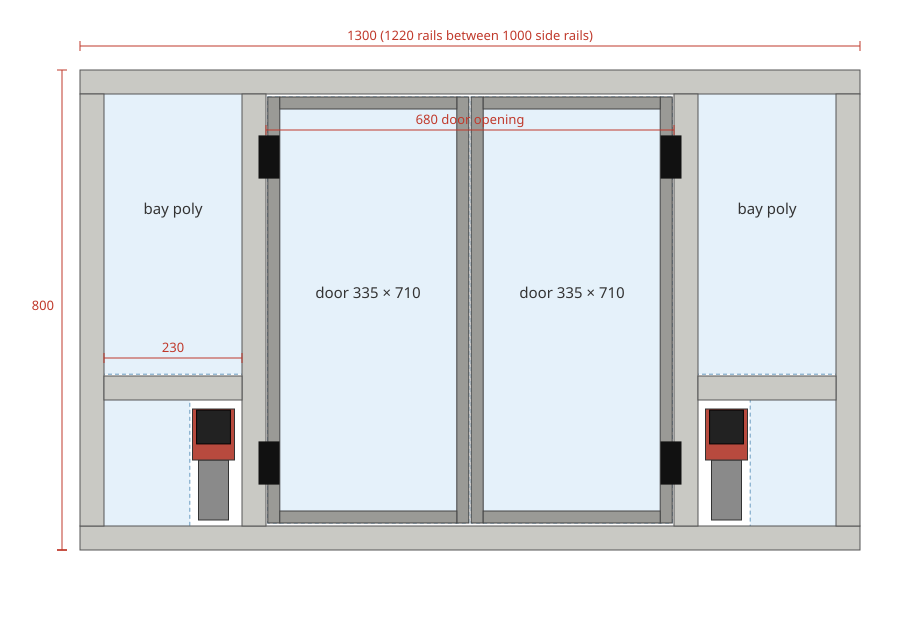
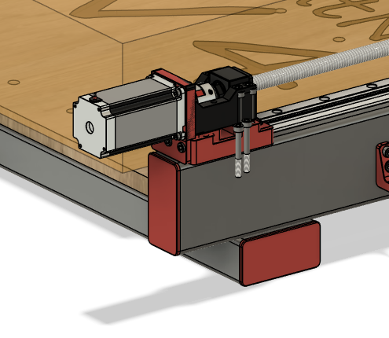

I'm building a chip enclosure around my PrintNC router: a 4040 aluminium
extrusion frame, 4.5 mm polycarbonate panels and two 2020-framed front doors on
3D-printed hinges. The awkward part is that both Y-axis stepper motors stick
out past the front of the machine, so the enclosure has to let them through
without leaving big holes for chips. The design is done in Fusion and the base
frame is built. This post covers how the design got to where it is, plus the
cut list.

## The brief

- Frame from 4040 extrusion (the common 8 mm single-centre-slot type), joined
  with inner corner brackets in all three directions.
- Polycarbonate sides screwed to the outside of the frame through to T-nuts,
  with 3 x 12 mm EPDM tape between poly and frame.
- Two front doors made from 2020 extrusion.
- No roof (the dust extraction hose comes in through the top) and no back panel.
- The enclosure sits on the same table as the machine, which is only about
  950 mm deep and backs onto a wall.
- Everything should be makeable from stock parts, my 3D printer or the CNC
  itself. I prefer T-nuts in slots and through-bolting to tapping threads.

Chip containment matters more to me than stiffness. A bolted 4040 box with
screwed-on poly sides is plenty rigid for this.

## The constraint: Y motors out the front

My PrintNC's Y axis runs on 1610 ballscrews driven by steppers that hang off
the front end of each Y rail, on HM12 mounts. The Y rail tubes themselves sit
on the base beams and extend forward past them, about 50 mm above the table.

That gives the front of the enclosure two jobs:

1. The bottom front 4040 rail has to slide **under** the Y tube ends. The
   50 mm lift leaves 10 mm of clearance over a 40 mm rail.
2. Each motor and its mount have to pass **through** the front face, in a
   gap between the corner post and a second upright set in from each corner.

I took the machine dimensions from my existing PrintNC model in Fusion and
dropped simplified placeholder blocks for the base beams, Y tubes, motors,
gantry and spindle into the enclosure model. That turned every clearance
question into a measurement instead of a guess, and caught a few problems
early (below).

## How the front bays evolved

The doors hang on the two inner uprights, so the space between each corner post
and inner upright is a "bay" the Y motor passes through. This went through a
few rounds:

1. **Inner upright 120 mm from the corner, with a square cutout in the bay
   poly for the motor.** Placing the machine model showed the 57 mm motor body
   would only have about 1.5 mm each side. Worse, the mount is wider than the
   motor and sat right where the upright was.
2. **Uprights moved in, with horizontal 4040 rails above and below the motor.**
   This replaced the cutout with a framed opening, but the lower rail can't
   exist: the Y tube passes through exactly where it would go.
3. **One rail above the motor only.** The bay is open from the bottom rail up
   to a short horizontal rail just above the motor mount. The inner upright
   sits 12.5 mm inboard of the mount.

Then the poly. Rectangles cut by the supplier were a hard requirement, so no
custom cutouts. I briefly tried three strips that closed in tightly around the
mount, but it looked fussy. The final version uses two pieces per bay, each
screwed down on three sides:

- **Upper piece:** full bay width, from just above the short rail to the top.
  Screwed to the corner post, inner upright and top rail. The bottom edge is free.
- **Lower piece:** outboard of the motor, from the bottom rail up to the short
  rail. Screwed to the corner post, bottom rail and short rail. The edge
  beside the motor is free, with 4.5 mm clearance.

What's left open around each motor is a 12.5 mm gap on the inboard side, a
narrow slot beside the Y tube and a small gap above the mount. Brush strip can
close those later if they turn out to matter.

## Doors

The doors are inset into the 680 mm opening between the inner uprights, with
their front faces flush with the 4040 frame. Each door is a 2020 frame of
335 x 710 mm with 4.5 mm poly screwed to its **outer** face over EPDM, rather
than sitting in the 2020 slot:

- A chip or broken tool hitting the poly from inside pushes it against the
  frame, not off the screws.
- 3 mm poly in a 6 mm slot would rattle.
- The doors, bays and sides all end up in the same plane.

I rounded the door sizes down to the nearest 5 mm so the 2020 cuts are easy
(740 and 295 at first, now 710 and 295), and let the gaps absorb the
difference: 3 mm at the hinges, 4 mm in the middle and 5 mm top and bottom.

## Printed hinges

Commercial 2020 hinges put the pivot too close to the frame for a door whose
poly sits in the same plane as the poly next to it. So I designed a printed
three-knuckle butt hinge:

- 72 mm tall with a 14 mm knuckle. The pivot sits about 14 mm in front of the
  frame, so the hinge-side edge of the door poly swings clear of the bay poly.
- The pin is an M5 x 80 socket head cap screw I already had, with a washer and
  a nyloc nut done up just snug. The knuckle stack length was set to suit that
  screw.
- Each leaf bolts with two M5 screws through the poly into a T-nut in the slot
  behind: the post leaf into the inner upright, the door leaf into the 2020
  stile.
- Two hinges per door, centred 100 mm from each end of the door (145 and
  655 mm above the table). The lower hinge sits below the bay poly, so its
  post leaf is 7.5 mm thicker to make up for the missing poly and EPDM.
  Otherwise all the hinges are the same.
- Each leaf prints flat with the knuckle on the bed: no supports, and the
  layers run the strong way through the knuckle.

One side effect of the motors sticking out about 125 mm in front of the frame:
each door can only open about 115 degrees before it would hit its motor. I'll
probably add a printed bump stop.

The magnetic catches will go on a stop block on the bottom front rail, behind
the bottom of each door.

## Poly panels and holes

All the poly is 4.5 mm. The side panels are inset 3 mm from the frame edges.
The screw holes sit on the slot centrelines at about 150 mm maximum pitch, with
a hole near every corner. A few details:

- **Oversized holes.** Polycarbonate expands roughly 1.3 mm per metre over a
  20 degree temperature swing, so the frame-panel holes are 7 mm for M5
  screws. The door holes are 6 mm.
- **No holes over the corner rail ends.** On the front face, the outer 40 mm
  at each corner is the end of a side rail, which has no slot to take a T-nut,
  so the hole pattern stops short of it.
- **Hinge bolts are part of the pattern.** The hinge leaf holes double as
  poly mounting holes, so they line up by design.
- **Doors flush with their frames.** With a 3 mm inset, holes on the 2020 slot
  centreline would only be 7 mm from the poly edge. Making the door poly the
  same size as the door frame gives 10 mm.

With the machine centred in the enclosure, the left and right panels are
mirror images, so ten panels need only four cutting templates. The two bay
templates are small enough to cut on the PrintNC itself.

## Final dimensions

When the extrusion arrived, the lengths I had on hand changed the frame
slightly from the original 1200 x 1000 x 830 plan:

- The front and back rails are 1220 mm and sit **between** the side rails, so
  the overall width is 1300 mm.
- The side rails are 1000 mm. The back rails and back uprights are set 925 mm
  back from the front, so the side rails overhang 75 mm at the rear and butt
  against the wall.
- The uprights are 720 mm, giving an overall height of 800 mm.

That extra width brought a bonus: about 95 mm of clearance either side of the
machine, so I could centre it rather than offset it towards the cable chain side.

At the back, the bottom back rail sits partly under the ends of the Y tubes,
which is fine because they're 50 mm off the table. When the gantry is fully
back, its X cable chain supports overhang the back rails slightly, but well
above the bottom rail and below the top one. The open back is mostly covered by
an acrylic chip guard I'd already fitted along the back of the baseboard,
about 100 mm high between the Y rails.

## Cut list

**4040 extrusion**

| Part | Qty | Length (mm) |
|---|---|---|
| Front/back rails, top and bottom | 4 | 1220 |
| Side rails, top and bottom | 4 | 1000 |
| Uprights (4 corner, 2 door) | 6 | 720 |
| Bay rails above the Y motors | 2 | 230 |

**2020 extrusion (doors)**

| Part | Qty | Length (mm) |
|---|---|---|
| Stiles | 4 | 710 |
| Rails | 4 | 295 |

**4.5 mm polycarbonate**

| Panel | Qty | Size (mm) | Holes |
|---|---|---|---|
| Sides | 2 | 919 x 794 | 24 x 7 mm |
| Doors | 2 | 335 x 710 | 19 x 6 mm |
| Bay, upper | 2 | 304 x 504 | 12 x 7 mm |
| Bay, lower | 2 | 180 x 284 | 7 x 7 mm |

The bay rail and bay panel sizes depend on exactly where the Y motor mounts
land, so I'm checking those against the real machine before cutting them.

## Next

- Confirm the motor-to-upright clearance on the real machine, then cut the
  bay rails.
- Order the sides and doors; cut the small bay panels on the PrintNC.
- Print the hinges, door stops and magnet mounts, and hang the doors.
- Then see where chips actually escape: likely the door gaps and the slots
  beside the Y motors.

The whole model was built parametrically in Fusion (overall size, machine
position, clearances, poly thickness and inset are all parameters), with
Claude driving Fusion through its MCP connection to do the modelling and
clearance checks while I made the decisions. That made the many layout
changes above cheap to try.
