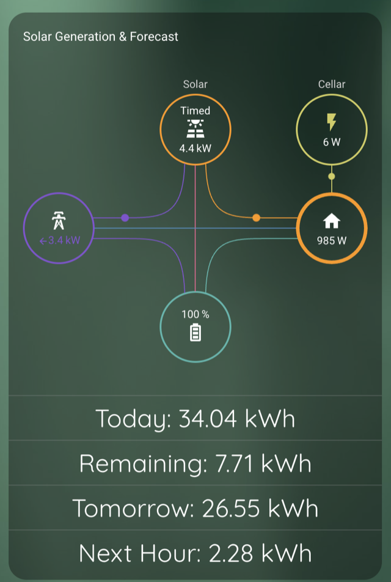

My Qcells hybrid inverter and battery doesn't have a Home Assistant integration,
and I didn't want to depend on the cloud app. It does have a local installer web
page, though, and behind it is a small JSON API on the inverter itself. I use the
[Multiscrape](https://github.com/danieldotnl/ha-multiscrape) custom integration
to log in to that page, read solar, battery and grid power every minute, and
post commands that switch the battery between self-consumption and grid
charging. Everything stays on the LAN, and the readings feed Home Assistant's
Energy dashboard and the power-flow card on my wall tablet (above).

This post covers how it fits together and the config, as of Multiscrape 9.2.1
and Home Assistant 2026.11.

## How the inverter's local page works

The inverter serves an installer page over HTTPS on port 7000, with a
self-signed certificate. Logging in is a form with only a password field. Once
you're logged in, the page's own JavaScript fetches JSON from a few endpoints,
which you can see in the browser's developer tools. These are the ones I use:

| Endpoint | Method | What it returns or does |
|---|---|---|
| `/login` | POST (form) | Logs in and sets a session cookie |
| `/system/status/pcssystem` | GET | Live status: battery charge, and solar, battery, grid and inverter power |
| `/config/allnvm` | GET | Stored settings, including the current `energy_policy` |
| `/install/device` | POST (JSON) | Changes settings, e.g. `{"energy_policy": 3}` |
| `/install/battery-sync` | POST | Battery sync, which I run after every policy change |

`energy_policy` is a number. The two values I use are **1 = Self Consumption**
(the battery charges from solar and powers the house) and **3 = Time Based**,
which is what I use to charge the battery from the grid.

These endpoints aren't documented, so a firmware update could change them.
Treat this as "works on my inverter", and check your own in the browser first.

## Why Multiscrape

Home Assistant's built-in REST integration can read JSON, but it can't do the
login step first. Multiscrape can: its `form_submit` block posts the login form,
keeps the session cookie and then requests the actual resource, logging in again
whenever the session expires. One Multiscrape config entry (a "scraper") can
also create several sensors from a single request, so one call per minute gives
me all five live readings.

Multiscrape is installed through HACS. Its config lives in `configuration.yaml`,
not the UI.

## Reading the live values

This scraper polls the status endpoint every 60 seconds and creates five
sensors. The inverter's address is `192.168.1.x` here; use your own.

```yaml
multiscrape:
  - name: QCells Scraper
    resource: https://192.168.1.x:7000/system/status/pcssystem
    scan_interval: 60
    timeout: 10
    verify_ssl: false          # the inverter uses a self-signed certificate
    log_response: false
    form_submit:
      submit_once: false       # log in before each scrape; sessions expire
      resource: https://192.168.1.x:7000/login
      input:
        password: !secret qcells_password
    sensor:
      - unique_id: qcell_battery_percentage_raw
        name: Battery Percentage
        value_template: "{{ value_json.current_avg_soc | float | round(2) }}"
        device_class: battery
        state_class: measurement
        unit_of_measurement: "%"
      - unique_id: qcell_solar_generation_raw
        name: Solar Power
        value_template: "{{ value_json.ess_all.pv_info.total_power | int }}"
        device_class: power
        state_class: measurement
        unit_of_measurement: W
      - unique_id: qcell_battery_power_raw
        name: Battery Power
        value_template: "{{ value_json.ess_all.inverter_info.bdc.power | int }}"
        device_class: power
        state_class: measurement
        unit_of_measurement: W
      - unique_id: qcell_grid_raw
        name: Grid
        value_template: "{{ value_json.meter_info.grid_active_power | float | round(2) }}"
        device_class: power
        state_class: measurement
        unit_of_measurement: W
      - unique_id: qcell_usage_inv_raw
        name: Inverter Generation
        value_template: "{{ value_json.ess_all.inverter_info.inv.active_power | int }}"
        device_class: power
        state_class: measurement
        unit_of_measurement: W
```

A second scraper reads the current energy policy every five minutes:

```yaml
  - name: QCells Energy Policy Scraper
    resource: https://192.168.1.x:7000/config/allnvm
    scan_interval: 300
    verify_ssl: false
    log_response: false
    form_submit:
      submit_once: false
      resource: https://192.168.1.x:7000/login
      input:
        password: !secret qcells_password
    sensor:
      - unique_id: qcells_energy_policy
        name: Qcells Energy Policy
        value_template: "{{ value_json.energy_policy | int }}"
        # no state_class: it's a mode number, not a measurement
```

The password lives in `secrets.yaml`, so it never ends up in a config repo or a
forum post.

## Sending commands

Multiscrape doesn't have a "button" type, but a scraper can send a POST with a
payload, and `scan_interval: 0` stops it from running on a schedule. Each one
then only runs when you call its `multiscrape.trigger_<name>` action, which
makes it a command you can call from automations, scripts or dashboard buttons.

```yaml
  - name: QCells Set Energy Policy to Time Based
    resource: https://192.168.1.x:7000/install/device
    scan_interval: 0           # never run on a schedule, only when triggered
    max_retries: 0             # don't resend a command if it fails
    method: POST
    headers:
      content-type: "application/json"
    payload: '{"energy_policy": 3}'
    verify_ssl: false
    log_response: false
    form_submit:
      submit_once: false
      resource: https://192.168.1.x:7000/login
      input:
        password: !secret qcells_password
    sensor:
      - unique_id: qcells_set_energy_policy_response_code_tb
        name: Time Based Set Policy Response Code
        value_template: "{{ value_json.error_code | int }}"
```

I have three of these: "Self Consumption" (the same with `{"energy_policy": 1}`),
"Time Based", and "Battery Sync", which posts to `/install/battery-sync`. Each
one's sensor records the `error_code` the inverter sends back, so I can see
whether the last command worked.

Multiscrape names the action after the scraper's `name`, so the ones above
become:

- `multiscrape.trigger_qcells_set_energy_policy_to_self_consumption`
- `multiscrape.trigger_qcells_set_energy_policy_to_time_based`
- `multiscrape.trigger_qcells_battery_sync`
- `multiscrape.trigger_qcells_energy_policy_scraper` (re-reads the policy straight away)

## From power readings to the Energy dashboard

The inverter reports signed power: grid power is positive when importing and
negative when exporting, and battery power is positive when discharging and
negative when charging. The Energy dashboard wants separate, always-positive
values for each direction, so four template sensors split them:

```yaml
template:
  - sensor:
      - name: Grid Consumption
        unique_id: grid_consumption_template
        unit_of_measurement: W
        device_class: power
        state_class: measurement
        state: "{{ [states('sensor.qcell_grid_raw') | float(0), 0] | max }}"
        availability: "{{ has_value('sensor.qcell_grid_raw') }}"

      - name: Grid Feed In
        unique_id: grid_feedin_template
        unit_of_measurement: W
        device_class: power
        state_class: measurement
        state: "{{ [states('sensor.qcell_grid_raw') | float(0) * -1, 0] | max }}"
        availability: "{{ has_value('sensor.qcell_grid_raw') }}"

      # Battery Consumption and Battery Charge are the same pattern
      # on sensor.qcell_battery_power_raw
```

From there it's all UI helpers, no YAML:

1. **Integral** helpers (Settings → Devices & services → Helpers → Integral)
   turn each power sensor into energy: left Riemann sum, `k` prefix, per hour,
   so watts become kWh.
2. **Utility meter** helpers reset those totals daily.
3. The **Energy dashboard** uses those daily meters for grid import, grid
   export, solar production, and battery charge and discharge.

The `availability` templates matter. Without them, a failed scrape reads as 0 W
instead of "unavailable", and the integrals quietly count those gaps as zero
power instead of skipping them.

## Automations: none, for now

I'm currently on an electricity plan with three free hours a day, so I don't
have any automations choosing the mode for me. The sensors drive the dashboards
and the Energy dashboard, and the command scrapers are there for when I want to
switch modes myself.

If you do want to automate it, the trigger actions work like any other action.
For example, this resets the policy to Self Consumption at midnight:

```yaml
alias: Reset Solar Policy to Self Consumption at Midnight
triggers:
  - trigger: time
    at: "00:00:00"
conditions:
  - condition: numeric_state
    entity_id: sensor.qcells_energy_policy
    above: 1
actions:
  - action: multiscrape.trigger_qcells_set_energy_policy_to_self_consumption
  - delay: "00:00:03"
  - action: multiscrape.trigger_qcells_battery_sync
mode: single
```

For anything more involved, follow each command with
`multiscrape.trigger_qcells_energy_policy_scraper`, then wait for
`sensor.qcells_energy_policy` to show the new value before treating the change
as done. The command scrapers only tell you the inverter accepted the request,
not that the setting actually changed.

On the wall tablet, the power-flow card shows a small "Timed" or "Self" label
under the solar circle, taken from `sensor.qcells_energy_policy`, so I can see
at a glance which mode the inverter is in.

## Gotchas I hit with Multiscrape 9.x

- **Entity IDs come from `unique_id`, not `name`.** The battery sensor is
  `sensor.qcell_battery_percentage_raw`, not `sensor.battery_percentage`.
  Templates written against the old names just showed `unknown`.
- **`verify_ssl` goes on the scraper, not inside `form_submit`.** Putting it in
  the `form_submit` block fails config validation.
- **Set `max_retries: 0` on command scrapers.** 9.1.0 added retries on failure,
  which is good for reading values but not for "change the inverter's energy
  policy". I don't want a command sent twice.
- **Don't give a mode sensor a `state_class`.** I originally had
  `state_class: measurement` on the energy policy sensor, so Home Assistant kept
  long-term statistics for a mode number. Removing it raised a "state class
  removed" repair, which you clear by deleting the old statistics.
- **After upgrading, my sensors stayed `unknown`/`unavailable`** until I
  reinstalled the integration from HACS and restarted Home Assistant. A reload
  alone didn't fix it.
- **Keep `log_response: false`** unless you're debugging. With it on,
  Multiscrape writes every page and form response to disk, including the login
  exchange.

## Takeaways

- If a device has a local web UI, check its network traffic in the browser
  before giving up on a missing integration. There's often a JSON API behind it.
- Multiscrape's `form_submit` handles sites that need a login, and
  `scan_interval: 0` plus `multiscrape.trigger_*` turns a scraper into a
  command.
- Split signed power into positive values with templates, then let the UI
  Integral and Utility meter helpers do the energy maths for the Energy
  dashboard.
- For anything that changes device settings, re-read the state after the
  command, and don't let it retry on its own.
